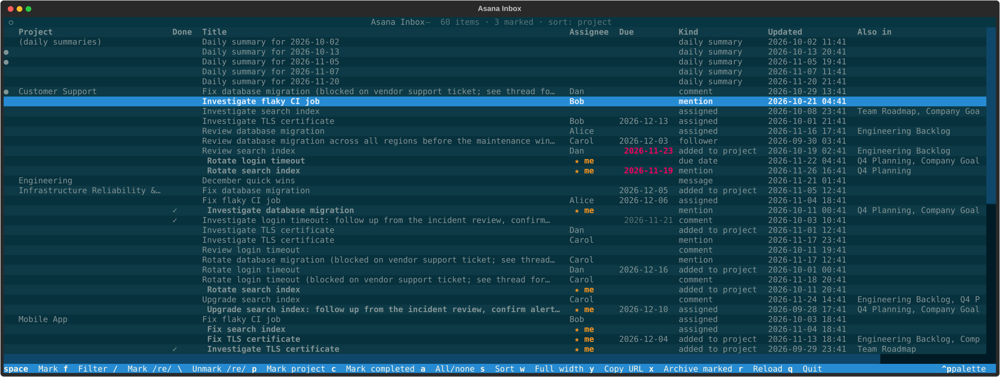
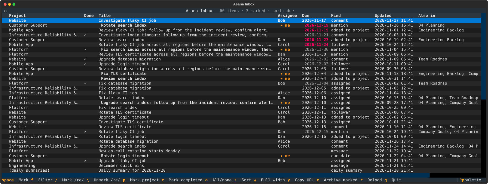
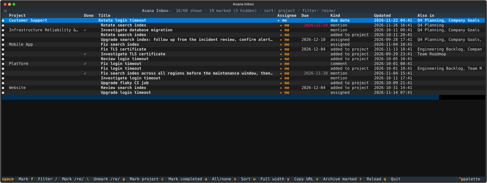
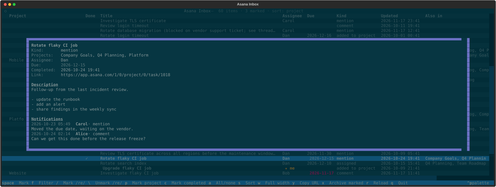
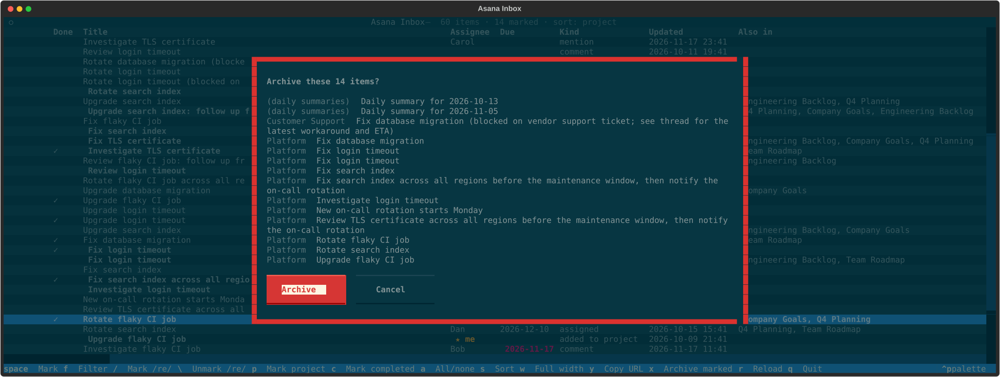

# asana-inbox

A terminal UI for bulk-archiving your Asana Inbox. You can group items by project, filter them, mark them by regex, and archive many at once.

It uses Asana's public [notifications API](https://developers.asana.com/reference/notifications) with a personal access token.

[](https://raw.githubusercontent.com/sochotnicky/asana-inbox/main/docs/main.svg)

## Screenshots

All screenshots use the built-in fake data (`./asana_inbox.py --fake`).

| | |
| --- | --- |
| **Sorted by due date**: overdue in red, due today in yellow | **Filtered** with `l mine`, then all shown rows marked with `v` |
| [](https://raw.githubusercontent.com/sochotnicky/asana-inbox/main/docs/sort-due.svg) | [](https://raw.githubusercontent.com/sochotnicky/asana-inbox/main/docs/filter.svg) |
| **Details** (`Enter`): description, projects and notifications | **Archive confirmation** (`a`) listing what will be archived |
| [](https://raw.githubusercontent.com/sochotnicky/asana-inbox/main/docs/details.svg) | [](https://raw.githubusercontent.com/sochotnicky/asana-inbox/main/docs/archive.svg) |

Regenerate them with `./docs/screenshots.py`.

## Requirements

- [uv](https://docs.astral.sh/uv/). It installs Python and the dependencies on first run.
- An Asana personal access token.

## Setup

1. Create a personal access token in Asana: profile picture → *Settings* → *Apps* → *Developer apps* → *Create new token* (or go to <https://app.asana.com/0/my-apps>).
2. Save it where the tool can find it, either in a file:

   ```sh
   mkdir -p ~/.config/asana-inbox
   install -m 600 /dev/stdin ~/.config/asana-inbox/token   # paste the token, then Ctrl-D
   ```

   or in the `ASANA_TOKEN` environment variable.

The token acts as you, with your full access, so treat it like a password. If your account has more than one workspace, also set `ASANA_WORKSPACE=<workspace gid>`; the tool lists the choices if it's missing.

## Running

```sh
./asana_inbox.py            # or: uv run asana_inbox.py
./asana_inbox.py --fake     # try the UI on generated data, no Asana needed
```

Rows appear as soon as the notifications are listed. Projects, due dates, assignees and completion are fetched afterwards in batches; until then the Project column shows `…` and the header counts the rows still loading.

### How it maps to Asana's Inbox

- The tool shows **unread** notifications, one row per task (or message, daily summary, …). Archiving a row marks its notifications read, through the same read state the web Inbox uses.
- The API can't archive notifications, so read ones stay in the web Inbox's *All* view until you archive them there. They don't show up in this tool.
  To make the web Inbox match this tool, set its *Activity* tab's filter to **Unread**: rows you archive here then disappear there too.
- Every load pages through all notifications that aren't archived, read ones included, 100 per request, so a very full Inbox loads more slowly. `-n N` scans only the newest N.

### Other options

| Option / env | Purpose |
| --- | --- |
| `--ignore-project NAME` / `ASANA_IGNORE_PROJECTS=a,b` | Don't group by broad projects like "Company Goals" when a task has more specific ones. |
| `-n N` | Scan only the newest N notifications (default: all). |
| `--workspace GID` / `ASANA_WORKSPACE` | Workspace to use if you have several. |

## Using it

Each row is one task (or message, daily summary, …) with unread notifications. Archiving a row marks those notifications read.

For tasks, the Kind column says why you got the notification: the most important reason among the row's unread notifications, in this order: `assigned`, `mention`, `comment`, `approval`, `due date`, `completed`, `reopened`, `unassigned`, `follower`, `added to project`, `reaction`, `liked`. The details view lists every notification. Kinds are matchable like everything else, so `/reaction|liked` marks all rows you only got because of a like, and `/added to project` marks tasks you only see because they were added to a project you follow.

Messages (team or project posts) show their full text in the details view and are grouped by where they were posted. This uses `GET /messages/{gid}`, which works but isn't in Asana's API reference.

| Key | Action |
| --- | --- |
| `↑`/`↓`, `PgUp`/`PgDn` | Move |
| `Enter` | Details: description, comments and other notifications, link |
| `space` | Mark / unmark row |
| `p` | Mark / unmark all shown rows in this row's project |
| `c` | Mark / unmark all shown completed tasks |
| `v` | Mark / unmark all shown rows (as in ranger) |
| `/` and `\` | Mark / unmark shown rows matching a regex |
| `l` | Filter ("limit", as in mutt) by regex (`Esc` or an empty filter clears it) |
| `s` | Cycle sort: project → title → newest → oldest → due |
| `w` | Toggle shortening long titles (72 chars) and the Project column (30 chars) |
| `y` | Copy the row's Asana link to the clipboard (OSC 52; in tmux, set `set-clipboard on`) |
| `o` | Open the row's Asana link in your browser (also in the details view) |
| `f` | Create a follow-up: a task assigned to you, due today, titled "Follow up on <title>" with the row's link in its description; then archive the row (also in the details view) |
| `F` | Custom follow-up: choose its title, description (prefilled with the row's link) and due date first, and whether to archive the row |
| `a` | Archive marked rows (asks for confirmation). In the details view: archive that item right away |
| `r` | Reload from Asana |
| `q` | Quit |

The regex for `l`, `/` and `\` matches the project, title, other projects, kind and assignee, plus the words `done` (completed tasks) and `mine` (assigned to you). For example, `l mine` shows only your tasks, and `/Support Triage` marks every row in that project.

In the details view, mentions show as a highlighted `@Full Name`. In the web UI, hover over one to see the person's email; in the TUI it's a `mailto:` link, which terminals with clickable links show on hover. Links to tasks and projects show the linked item's name and are clickable.

Follow-up tasks go to your My Tasks, outside any project. In the `F` dialog the due date takes `YYYY-MM-DD`, `today`, `tomorrow`, `+N` (days) or a weekday name (the next one); the web UI uses a date picker with Today / Tomorrow / +1 week buttons. With `--fake`, follow-ups are only pretend.

Bulk marking only affects rows the current filter shows. Marks survive filter changes, and the archive confirmation says how many marked rows are hidden.

In the table:

- **★ me** and a bold title: tasks assigned to you.
- **✓** in the Done column: completed tasks.
- **Due** column: overdue dates in red, today's in yellow.

After archiving, rows disappear immediately; press `r` to re-sync with Asana.

To change the color theme, open the command palette with `ctrl+p` and choose *Change theme*. The theme and the `w` setting are saved in `~/.config/asana-inbox/settings.json` (or under `$XDG_CONFIG_HOME`).

## Web UI

`asana_inbox_web.py` is a prototype browser version of the same UI. It runs a small local server on 127.0.0.1. Tokens stay in that process; the browser only gets a session cookie.

```sh
./asana_inbox_web.py --fake       # demo on the generated data, no Asana needed
./asana_inbox_web.py              # personal access token; open http://127.0.0.1:8765/
./asana_inbox_web.py --port 9000
```

It picks how to sign in like this:

1. `--fake`: generated data, no sign-in.
2. **OAuth** ("Log in with Asana"), when a client id and secret are configured (see below). Each browser session gets its own login and inbox.
3. Otherwise, the **personal access token** from [Setup](#setup), shared by every tab.

`--workspace`, `-n` and `--ignore-project` (and their env vars) work as in the TUI. With `--fake`, rows appear first and their details fill in over a few seconds, like a real load. Archiving in fake mode only removes rows from memory, and `r` starts the demo fill-in again.

### OAuth setup

1. In the Asana developer console (<https://app.asana.com/0/my-apps>), create an app.
2. Under *OAuth*, add this redirect URL exactly: `http://localhost:8765/auth/callback`. Use your port if you pass `--port`, or whatever you set with `--redirect-uri` / `ASANA_REDIRECT_URI`.
3. Give the app full permissions. By default the login asks for the app's full permissions, because Asana serves message text only to tokens that have them ("Full permissions are required to use this endpoint"). This means every login gives the web UI full access to that person's Asana account. To ask for less, pass `--scopes` / `ASANA_SCOPES` with a space-separated list; the tool needs `notifications:read notifications:write tasks:read tasks:write projects:read users:read workspaces:read stories:read`, and the app's permissions must allow whatever you ask for. With that narrower list, messages show the 403 error in their details instead of their text.
4. Give the tool the client id and secret, either in the environment:

   ```sh
   export ASANA_CLIENT_ID=<client id>
   export ASANA_CLIENT_SECRET=<client secret>
   ```

   or in a file that only you can read:

   ```sh
   install -m 600 /dev/stdin ~/.config/asana-inbox/oauth-client.json   # then Ctrl-D
   {"client_id": "<client id>", "client_secret": "<client secret>"}
   ```

   `--client-id` and `--client-secret` also work, but command-line arguments are visible to other users of the machine.
5. Run `./asana_inbox_web.py` and open the URL it prints, `http://localhost:8765/`. Use the same host as the redirect URI (`localhost`, not `127.0.0.1`), because the login cookies belong to that host. Visiting `/auth/login` on another host redirects you there.

Logins last until you log out or the server stops; nothing is saved to disk. Access tokens are refreshed automatically before they expire, and again if Asana rejects one. If the refresh fails, the page shows the login screen again.

### Logo and favicon

There's no logo by default. To show one next to the title and as the browser-tab icon, give an image URL:

| Option / env | Purpose |
| --- | --- |
| `--logo-url URL` / `ASANA_INBOX_LOGO_URL` | Image next to the title (and on the login screen) |
| `--favicon-url URL` / `ASANA_INBOX_FAVICON_URL` | Browser-tab icon; defaults to the logo |
| `--img-src SOURCES` / `ASANA_INBOX_IMG_SRC` | The page's Content-Security-Policy `img-src`, used as given instead of the default |

Both take `https://`, `http://` or `data:image/…` URLs. By default the page's Content-Security-Policy allows images only from itself and the origins of the URLs you give. To set it yourself, for example to allow a whole CDN or a wildcard, pass space-separated CSP sources: `ASANA_INBOX_IMG_SRC="'self' https://*.example.com data:"`. It replaces the default, so include every origin your logo and favicon come from. Only `img-src` can be changed this way: a value containing `;` is refused.

### Docker

The `Dockerfile` runs the web UI. Dependencies are installed when the image is built, so the container doesn't need to reach PyPI when it starts. It runs under `tini`, so Ctrl-C and `docker stop` shut it down right away.

```sh
docker build -t asana-inbox .
docker run --rm -p 8765:8765 asana-inbox --fake                     # demo data
docker run --rm -p 8765:8765 -e ASANA_TOKEN=… asana-inbox            # personal access token
docker run --rm -p 8765:8765 \
    -e ASANA_CLIENT_ID=… -e ASANA_CLIENT_SECRET=… \
    -e ASANA_REDIRECT_URI=http://localhost:8765/auth/callback asana-inbox   # OAuth
```

Then open <http://localhost:8765/>. Every setting is an env var (`ASANA_INBOX_LOGO_URL`, `ASANA_WORKSPACE`, `ASANA_SCOPES`, …), and anything after the image name is passed to `asana_inbox_web.py`. In the container the server listens on all interfaces; the page still only answers to `localhost` and the OAuth redirect URI's host. If you serve it under another name, for example behind a reverse proxy, add that name with `ASANA_ALLOWED_HOSTS=inbox.example.com` (comma-separated for several). For anything beyond your own machine, put it behind HTTPS and use an `https://` redirect URI, so the session cookie is marked Secure.

The keys are the same as in the TUI (see [Using it](#using-it)), with `j`/`k`, `Home`/`End` and the mouse as well. Press `?` (or the hint at the top of the page) for a list of all shortcuts. Click the ○ column to mark a row, double-click a row for details, and click any column header to sort by it (click again to reverse; Done puts completed tasks first, Assignee puts yours first, Kind orders by importance: assigned, mention, comment, …). The filter is the box in the toolbar: `l` focuses it, and it applies as you type. The page follows your system's light or dark mode; the ◐ button in the header switches between Auto, Light and Dark, and the choice is remembered in that browser.

## Command-line client

`asana_api.py` is the backend without the UI. It's handy for debugging:

```sh
./asana_api.py inbox [--details]           # unread items with ids (and projects, due dates, …)
./asana_api.py archive <id> [--yes]        # dry run unless --yes
./asana_api.py raw -n 20                   # raw notification JSON
```
